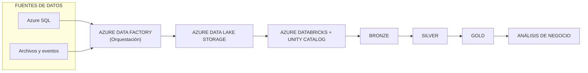

# Andina Retail — Plataforma de Ingeniería de Datos en Azure


**Proyecto final | P.E. Data Engineer**  

**Tecnologías:** Microsoft Azure, Azure Databricks, Apache Spark y PySpark.


## 1. Descripción del proyecto


Andina Retail es un caso de estudio de una cadena de tiendas de artículos para el hogar y electrodomésticos que opera mediante establecimientos físicos y canales de comercio electrónico.


El proyecto consiste en diseñar e implementar una plataforma de ingeniería de datos en Microsoft Azure que permita integrar información de distintas fuentes, procesarla mediante una arquitectura Lakehouse y generar información analítica para responder preguntas de negocio.


La solución integra datos transaccionales, archivos operacionales y eventos de comportamiento digital, transformándolos en información organizada y disponible para análisis.


## 2. Objetivos


- Integrar información de diferentes fuentes estructuradas y semiestructuradas.

- Implementar procesos de ingesta y almacenamiento en la nube.

- Transformar los datos mediante Apache Spark y PySpark.

- Organizar la información en las capas Bronze, Silver y Gold.

- Automatizar la ejecución de los procesos mediante Azure Data Factory y Databricks.

- Implementar controles de calidad e idempotencia.

- Construir tablas analíticas orientadas a las necesidades del negocio.


## 3. Arquitectura de la solución


La plataforma utiliza servicios de Microsoft Azure y Azure Databricks.


### Flujo general



Azure Data Factory coordina la ingesta y la ejecución del procesamiento. Databricks ejecuta los notebooks desarrollados con PySpark y Unity Catalog organiza los datos mediante esquemas.


### Servicios utilizados


| Servicio | Función |
|---|---|
| Azure Data Factory | Orquestación de procesos |
| Azure Data Lake Storage Gen2 | Almacenamiento de datos |
| Azure Databricks | Procesamiento distribuido |
| Apache Spark / PySpark | Transformación de datos |
| Unity Catalog | Organización y gobierno de datos |
| Azure SQL Database | Fuente transaccional |
| Azure Key Vault | Gestión de secretos |
| Managed Identities | Autenticación entre servicios |


## 4. Arquitectura Lakehouse


La solución implementa tres capas de procesamiento:


- **Bronze:** recepción y almacenamiento de los datos procedentes de las fuentes.

- **Silver:** transformación, normalización y aplicación de controles de calidad.

- **Gold:** generación de tablas analíticas orientadas a las preguntas de negocio.


### Tablas analíticas Gold


| Tabla | Descripción |
| --- | --- |
| `ventas_diarias` | Ventas por tienda, canal y día |
| `clientes_valor` | Valor y comportamiento de compra de clientes |
| `productos_rotacion` | Rotación y comportamiento de productos |
| `embudo_web` | Conversión del proceso de compra digital |
| `conciliacion_pagos` | Conciliación de pedidos, pagos y facturas |
| `ventas_importados_usd` | Análisis de productos importados y tipo de cambio |
| `segmentos_campania` | Segmentación para campañas |
| `auditoria_cargas` | Seguimiento y auditoría de las cargas |


## 5. Orquestación y procesamiento


### Azure Data Factory


El pipeline maestro `pl_pede_andina_diario` coordina la ingesta y el procesamiento de datos mediante Databricks.


El pipeline utiliza el parámetro `fecha` para gestionar la fecha de procesamiento.


El desencadenador `tg_pede_andina_0130` está configurado para ejecutarse diariamente a la 01:30, hora de Lima. Se encuentra publicado, pero permanece detenido.


### Azure Databricks


Se implementaron los siguientes Jobs:


- `job-pede-andina-e4`: procesamiento diario de las capas Bronze, Silver y Gold.

- `job-pede-andina-e4-horario`: procesamiento de clics y logs mediante Auto Loader, incluyendo la detección de archivos nuevos y tardíos.


## 6. Notebooks implementados


| Notebook | Responsabilidad |
|---|---|
| `e4_00_clics_logs_horario` | Procesamiento de clics y logs |
| `e4_01_bronce` | Ingesta y procesamiento de la capa Bronze |
| `e4_02_plata` | Transformaciones y controles de la capa Silver |
| `e4_03_oro` | Construcción de tablas analíticas Gold |


## 7. Extensiones propias


### E2 — Control de calidad de datos


Implementada en `e4_02_plata`.


Incorpora controles para validar:


- Estados HTTP dentro del rango 100–599.

- Latencias mayores o iguales a cero.


Incluye el parámetro `prueba_e2`, que permite introducir un registro sintético con estado HTTP 700 para comprobar que la validación detiene el procesamiento mediante una aserción (`assert`).


Se realizaron dos pruebas:


1. Prueba controlada con `prueba_e2=si`, que produjo el fallo esperado.

2. Ejecución normal con `prueba_e2=no`, que finalizó correctamente y conservó 146.282 registros en `pede_dev.silver.logs`.


### E3 — Segunda fecha de carga e idempotencia


Implementada en `e4_01_bronce`.


Permite realizar cargas para diferentes fechas utilizando el campo `_load_date`.


Al repetir una fecha, se eliminan los registros correspondientes a esa fecha antes de volver a cargar los datos, conservando los registros de otras fechas.


La prueba se realizó sobre las cinco tablas SQL: customers, products, orders, order_items y payments.


Se verificaron los conteos de registros para distintas fechas, incluyendo la repetición de una fecha previamente cargada.


## 8. Resultados y controles de calidad


Se verificaron los siguientes controles del proyecto:


| Indicador | Resultado |
|---|---:|
| Pedidos pagados de e-commerce | 1.425 |
| Importe e-commerce pagado | 5.339.767,44 |
| Importe de tiendas físicas | 1.003.274,99 |
| Pedidos sin pago | 75 |
| Facturas legibles | 137 de 140 |
| Sesiones con checkout | 333 |
| Eventos únicos | 34.530 de 35.043 |


Los resultados fueron contrastados con los controles definidos para el caso de estudio.


## 9. Estructura del repositorio


```text

pf-andina-liziac05/
├── adf/
│   ├── linked services/
│   ├── datasets/
│   ├── pipelines/
│   └── triggers/
├── notebooks/
│   ├── e4_00_clics_logs_horario.py
│   ├── e4_01_bronce.py
│   ├── e4_02_plata.py
│   └── e4_03_oro.py
├── evidencias/
├── README.md
├── DECISIONES.md
└── evidencia.md


```


La carpeta `adf/` contiene las definiciones JSON exportadas de Azure Data Factory. La carpeta `notebooks/` contiene los notebooks exportados desde Databricks.


## 10. Seguridad


La solución utiliza identidades administradas para la comunicación entre servicios de Azure cuando corresponde.


- Azure Data Factory utiliza System Managed Identity.

- Databricks accede al Data Lake mediante un Access Connector y Managed Identity.

- Azure Key Vault permite gestionar los secretos.

- No se deben incluir contraseñas, tokens ni claves de almacenamiento en el repositorio.


## 11. Documentación complementaria


- **`DECISIONES.md`:** justificación de las principales decisiones técnicas y de arquitectura.

- **`evidencia.md`:** registro de las pruebas, verificaciones y resultados obtenidos.


---

\*\*Plataforma: Microsoft Azure y Azure Databricks\*\*

